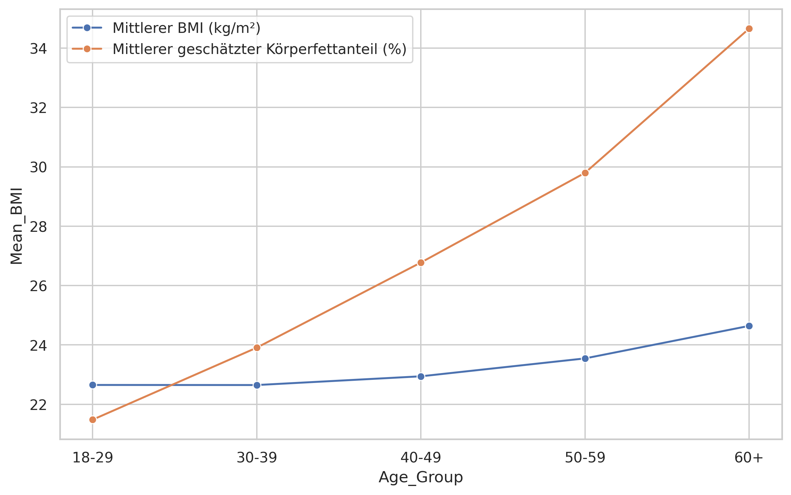
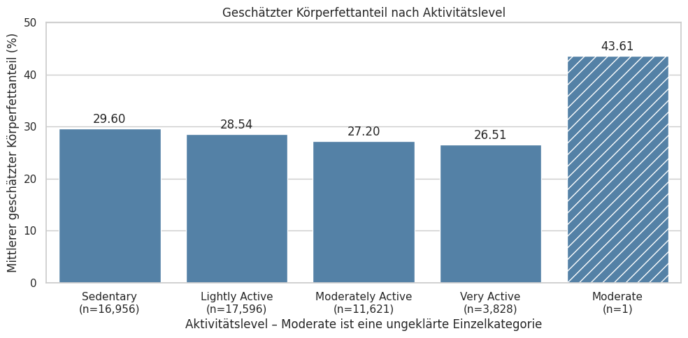
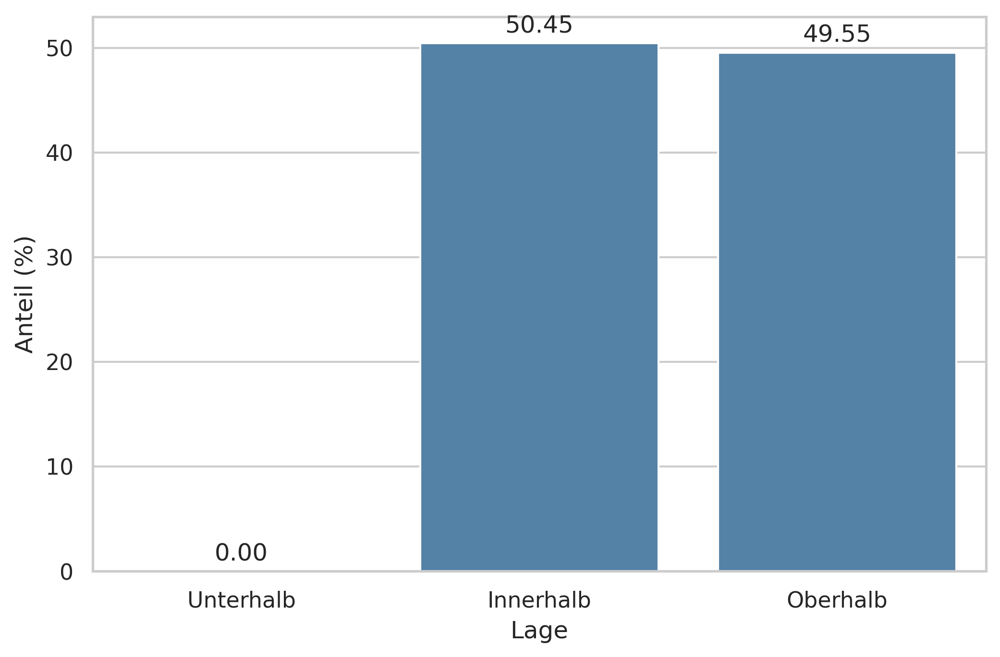

# Gesundheitsdatenanalyse mit Python

**Explorative Datenanalyse (EDA) | Datenqualität | BMI | Geschätzter Körperfettanteil | Körperliche Aktivität**

## 1. Projektübersicht

Dieses Projekt entstand im Rahmen meiner Weiterbildung zum Data Analyst.

Mit Python analysiere ich einen Gesundheitsdatensatz mit **50.002 Datensätzen und 11 Variablen**. Im Mittelpunkt stehen der Body-Mass-Index (BMI), der geschätzte Körperfettanteil sowie Unterschiede nach Alter, Geschlecht, körperlicher Aktivität und Raucherstatus.

Das Projekt umfasst sieben vorgegebene Analysefragen und drei eigenständig entwickelte Fragestellungen.

Neben der explorativen Datenanalyse liegt ein besonderer Schwerpunkt auf Datenqualität, nachvollziehbaren Berechnungen, aussagekräftigen Visualisierungen und der kritischen Interpretation der Ergebnisse.

### Die wichtigsten Erkenntnisse auf einen Blick

Die Analyse von 50.002 Gesundheitsdatensätzen liefert drei zentrale Ergebnisse:

- **BMI und Körperfett:** 49,55 % der Datensätze mit BMI im Normalbereich weisen einen geschätzten Körperfettanteil oberhalb des vorgegebenen Referenzbereichs auf.
- **Körperliche Aktivität:** Der durchschnittliche geschätzte Körperfettanteil beträgt 29,60 % bei inaktiven und 26,51 % bei sehr aktiven Personen.
- **Alter:** Der mittlere BMI steigt über die untersuchten Altersgruppen von rund 22,65 auf 24,64.

**Einordnung:** Der Körperfettanteil wurde anhand von BMI, Alter und Geschlecht geschätzt. Die Ergebnisse beschreiben Muster innerhalb des Datensatzes und erlauben keine kausalen oder medizinisch-diagnostischen Schlussfolgerungen.

## 2. Zentrale Forschungsfrage

**Welche Muster zeigen sich beim BMI und beim geschätzten Körperfettanteil in unterschiedlichen Bevölkerungs- und Aktivitätsgruppen, und welche Grenzen bestehen bei der Interpretation dieser Zusammenhänge?**

Zur Beantwortung werden folgende Themen untersucht:

- Unterschiede der BMI-Verteilung nach Geschlecht und Alter.
- Zusammenhänge zwischen körperlicher Aktivität und geschätztem Körperfettanteil.
- Unterschiede nach Raucherstatus.
- Übereinstimmungen und Abweichungen zwischen BMI-Kategorien und Körperfett-Referenzbereichen.

## 3. Datengrundlage

| Merkmal | Beschreibung |
|---|---|
| Datenquelle | Bereitgestellter Datensatz für ein Abschlussprojekt |
| Dateiname | `health_data_processed.csv` |
| Datensätze | 50.002 |
| Variablen | 11 |
| Dateiformat | CSV |
| Analyseumgebung | Python / Google Colab |

Der Datensatz enthält demografische Merkmale, Körpermaße, Aktivitätskategorien, Raucherstatus sowie daraus abgeleitete Gesundheitsindikatoren.

**Wichtiger Hinweis:** Der Körperfettanteil wurde aus BMI, Alter und Geschlecht geschätzt und nicht direkt gemessen. Er stellt daher keine unabhängige klinische Messung dar.

## 4. Verwendete Technologien

| Technologie | Verwendung |
|---|---|
| Python | Datenanalyse und Berechnungen |
| Pandas | Datenaufbereitung, Filterung und Aggregation |
| NumPy | Numerische Berechnungen |
| Matplotlib | Datenvisualisierung |
| Seaborn | Statistische Diagramme |
| Google Colab / Jupyter | Dokumentation und reproduzierbare Analyse |
| GitHub | Versionsverwaltung und Projektdokumentation |

## 5. Methodisches Vorgehen

Die Analyse folgt einem strukturierten Arbeitsablauf.

**Schritt 1 – Dateninspektion**

Überprüfung von Datensatzgröße, Spaltenstruktur, Datentypen und deskriptiven Kennzahlen.

**Schritt 2 – Datenqualitätsprüfung**

Untersuchung fehlender Werte, identischer Datensätze, uneinheitlicher Kategorien und auffälliger Wertebereiche.

**Schritt 3 – Validierung berechneter Merkmale**

Erneute Berechnung und Überprüfung von BMI, geschätztem Körperfettanteil und zugehörigen Klassifikationen.

**Schritt 4 – Explorative Datenanalyse**

Gruppierung und Vergleich der Daten nach Alter, Geschlecht, Aktivität und Raucherstatus.

**Schritt 5 – Visualisierung**

Darstellung der Ergebnisse durch geeignete Diagramme und Vergleichstabellen.

**Schritt 6 – Interpretation**

Einordnung der Ergebnisse unter Berücksichtigung der Datenqualität, möglicher Verzerrungen und methodischer Grenzen.

## 6. Datenqualität und Validierung

Die Datenqualitätsprüfung ergab folgende Befunde:

| Prüfung | Ergebnis |
|---|---|
| Fehlende Werte | Keine |
| Vollständig identische zusätzliche Zeilen | 96 |
| Uneindeutige Aktivitätskategorie | `Moderate` (1 Eintrag) |
| Abweichungen beim gespeicherten Körperfettstatus | 11 |
| Abweichungen oberhalb der Rundungstoleranz beim geschätzten Körperfettanteil | 4 |

Auffälligkeiten wurden untersucht und dokumentiert, statt sie ohne ausreichende Begründung automatisch zu verändern.

Insbesondere wurden unklare Kategorien und widersprüchliche Zuordnungen nachvollziehbar behandelt.

Dieses Vorgehen soll die Transparenz, Nachvollziehbarkeit und Reproduzierbarkeit der Analyse gewährleisten.

## 7. Zentrale Analyseergebnisse

### 7.1 BMI und Alter

Der mittlere BMI liegt in den beiden jüngsten Altersgruppen bei rund 22,65 und steigt in den folgenden Altersgruppen bis auf 24,64 bei Personen ab 60 Jahren. Die Ergebnisse beschreiben Unterschiede zwischen Altersgruppen innerhalb des Datensatzes und keine individuelle Entwicklung über die Zeit.

Dies beschreibt einen Zusammenhang innerhalb des Datensatzes. Daraus lässt sich kein kausaler Einfluss des Alters ableiten.




### 7.2 Körperliche Aktivität und geschätzter Körperfettanteil

Der durchschnittliche geschätzte Körperfettanteil unterscheidet sich zwischen den Aktivitätsgruppen.

| Aktivitätslevel | Durchschnittlicher geschätzter Körperfettanteil |
|---|---:|
| Sedentary | 29,60 % |
| Lightly Active | 28,54 % |
| Moderately Active | 27,20 % |
| Very Active | 26,51 % |




Die Ergebnisse zeigen innerhalb des Datensatzes einen niedrigeren durchschnittlichen geschätzten Körperfettanteil bei höheren Aktivitätsstufen.

Ein ursächlicher Effekt körperlicher Aktivität lässt sich daraus nicht nachweisen.

### 7.3 BMI und Körperfett-Referenzbereich

Von **37.022 Datensätzen mit einem BMI im Normalbereich** liegen:

- **50,45 %** innerhalb des vorgegebenen Körperfett-Referenzbereichs.
- **49,55 %** oberhalb des vorgegebenen Körperfett-Referenzbereichs.

Die Ergebnisse verdeutlichen, dass die BMI-Klassifikation und die Klassifikation anhand des geschätzten Körperfettanteils nicht immer übereinstimmen.

Da der Körperfettanteil unter anderem aus dem BMI berechnet wird, handelt es sich jedoch nicht um zwei vollständig unabhängige Messgrößen.





## 8. Grenzen der Analyse

Bei der Interpretation sind folgende Einschränkungen zu berücksichtigen:

- Der Körperfettanteil wurde geschätzt und nicht direkt gemessen.
- Einige Variablen sind durch ihre Berechnungsformeln mathematisch miteinander verbunden.
- Die Repräsentativität des Datensatzes ist nicht nachgewiesen.
- Beobachtete Zusammenhänge erlauben keine kausalen Schlussfolgerungen.
- Die Bedeutung einzelner Aktivitätskategorien ist nicht vollständig dokumentiert.
- Die verwendeten Referenzbereiche ersetzen keine individuelle medizinische Beurteilung.
- Festgestellte Datenabweichungen können die Genauigkeit einzelner Auswertungen beeinflussen.

Die Ergebnisse dienen ausschließlich analytischen und didaktischen Zwecken.

## 9. Projektstruktur

```text
health-data-analysis-python/
├── README.md
├── data/
│   └── health_data_processed.csv
├── figures/
└── notebooks/
    └── Suryandi_HealthDataExplorer.ipynb
```

Der Ordner `notebooks/` enthält die vollständige Python-Analyse.

Im Ordner `data/` befindet sich die verwendete CSV-Datei.

Der Ordner `figures/` ist für exportierte Visualisierungen vorgesehen.

## 10. Reproduzierbarkeit

Das Notebook lädt den Datensatz direkt aus dem GitHub-Repository.

Um die Analyse nachzuvollziehen:

1. Die Datei `notebooks/Suryandi_HealthDataExplorer.ipynb` in Google Colab oder Jupyter öffnen.
2. Bei Bedarf die benötigten Python-Bibliotheken installieren.
3. Eine Internetverbindung für den CSV-Abruf sicherstellen.
4. Die Laufzeit neu starten und sämtliche Zellen der Reihe nach ausführen.
5. Tabellen, Diagramme und Interpretationen überprüfen.

Benötigte Bibliotheken:

```bash
pip install pandas numpy matplotlib seaborn
```

Das Notebook wurde in Google Colab durch einen vollständigen Neustart mit anschließender Ausführung aller Zellen erfolgreich getestet.

## 11. Eigenständige Projektarbeit

Im Rahmen des Abschlussprojekts wurden sieben vorgegebene Fragestellungen und drei eigenständig entwickelte Analysefragen bearbeitet.

Zusätzlich wurden Datenqualitätsprüfungen, Validierungen berechneter Merkmale und kritische Ergebnisinterpretationen dokumentiert.

Der Schwerpunkt liegt nicht ausschließlich auf der technischen Umsetzung, sondern auch auf der Fähigkeit, analytische Ergebnisse verständlich, nachvollziehbar und verantwortungsvoll zu kommunizieren.

## 12. Fazit

Die Analyse zeigt Unterschiede beim BMI und beim geschätzten Körperfettanteil zwischen verschiedenen Alters-, Geschlechts- und Aktivitätsgruppen.

Besonders deutlich wird, dass BMI-Kategorien und Körperfett-Referenzbereiche nicht immer übereinstimmen.

Gleichzeitig verdeutlicht das Projekt die Bedeutung einer sorgfältigen Datenvalidierung: Berechnete Merkmale, Klassifikationen und Datenauffälligkeiten müssen überprüft werden, bevor daraus Schlussfolgerungen gezogen werden.

Das Projekt demonstriert einen vollständigen analytischen Arbeitsablauf von der Datenprüfung bis zur verständlichen Ergebnisdarstellung.

## 13. Autor

**Andy Suryandi**

Angehender Data Analyst

Schwerpunkte: SQL | Python | Power BI | Datenanalyse | Datenvisualisierung

[Mein GitHub-Profil](https://github.com/andysuryandi)

---

*Dieses Projekt wurde zu Ausbildungs- und Portfoliozwecken erstellt. Die Ergebnisse stellen keine medizinische Beratung dar.*
